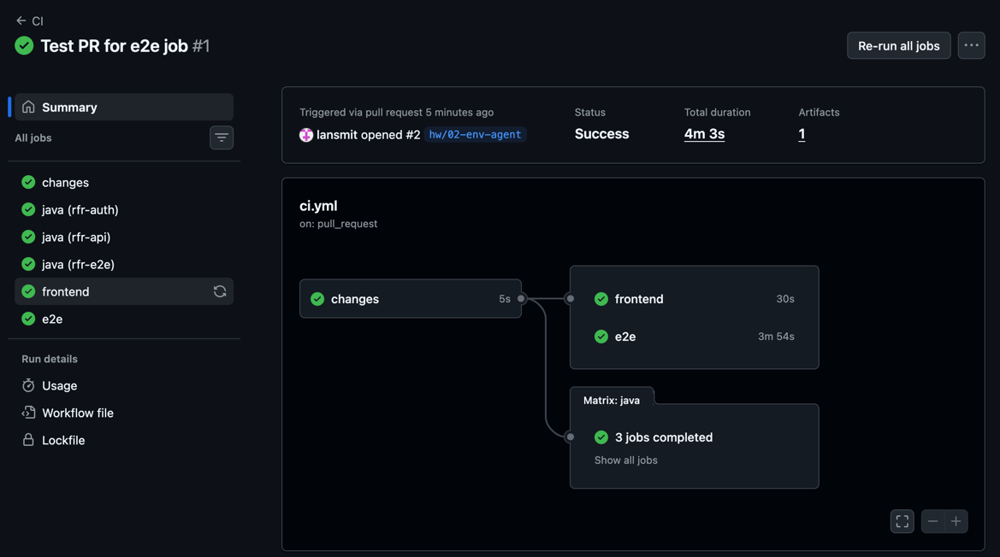

# Rangiffler

Rangiffler — приложение для путешественников: карта посещённых стран, лента фотографий из поездок, лайки и друзья. Название происходит от северного оленя (*Rangifer*), рекордсмена по расстояниям, которые он проходит по суше.

Это дипломный проект курса QA.GURU Advanced. Цель — перевести монолитный бэкенд на микросервисы и покрыть систему e2e- и API-тестами. Проект вырос из учебного шаблона: фронтенд, сервис авторизации и монолитный `rfr-api` с mock-лентой были даны. Тестовый фреймворк, тесты, окружение и настройка AI-агента сделаны в рамках диплома (см. [«Статус и планы»](#статус-и-планы) и [«История по занятиям»](#история-по-занятиям)).


## Архитектура

```
браузер ── rfr-gql-client (React, :3001)
              │  OAuth 2.1 / OIDC (PKCE)          │  GraphQL + access token
              ▼                                   ▼
          rfr-auth (:9001) ──── JWKS ────► rfr-api (:8081)
              │                                   │
              ▼                                   ▼
        MySQL: rangiffler-auth             MySQL: rangiffler-api
```

| Модуль | Роль | Подробнее |
|---|---|---|
| `rfr-auth` | Spring Authorization Server: логин, регистрация, выпуск access token с `aud: rangiffler-api` и правами `read`/`write` | [rfr-auth/README.md](rfr-auth/README.md) |
| `rfr-api` | GraphQL API, OAuth2 resource server. Пользователи, страны и дружба — в БД; лента, фото, лайки и статистика — пока mock из JSON | [rfr-api/README.md](rfr-api/README.md) |
| `rfr-gql-client` | SPA на React + Apollo, написан под фиксированную GraphQL-схему; в проекте это тестируемая система и не меняется | [rfr-gql-client/README.md](rfr-gql-client/README.md) |
| `rfr-e2e` | UI-тесты: JUnit 6 + Playwright Java + Allure 3 | [rfr-e2e/README.md](rfr-e2e/README.md) |

Пользователи в двух БД связаны только по username, UUID у них разные. API-профиль создаётся при первом входе.

**Технические решения бэкенда** — пагинация через Connection-типы, модель дружбы с уникальностью пары в БД, списки пользователей со статусом дружбы одним запросом, контракт ошибок GraphQL, security — описаны с кодом в **[rfr-api/README.md → «Технические решения»](rfr-api/README.md#технические-решения)**.

## Технологии

- Сборка: Java 25, Gradle 9.7.1
- Backend: Spring Boot 4.1.1, Spring for GraphQL, DGS Codegen, Spring Security, JPA, Flyway
- Auth: Spring Authorization Server
- Frontend: React 19, TypeScript 6, Vite 8, Apollo Client 4, Material UI 9, React Router 8
- БД: MySQL 8.4 в Docker
- Тесты: JUnit 6, Playwright Java 1.63, Allure 3
- CI: GitHub Actions

## Структура репозитория

```
rfr/
├── rfr-auth/              # сервис авторизации
├── rfr-api/               # GraphQL API, миграции Flyway, mock-данные ленты
├── rfr-gql-client/        # фронтенд
├── rfr-e2e/               # e2e-тесты
├── .claude/
│   ├── settings.json      # разрешения, хуки и окружение AI-агента
│   ├── hooks/             # проверка кода после правки агента, запрет push и удаления файлов
│   └── skills/            # skill rfr-page-objects: правила Page Object
├── CLAUDE.md              # инструкции для AI-агента (+ CLAUDE.md в каждом модуле)
├── .mcp.json              # Playwright MCP
├── docker-compose.yml     # MySQL для локального стенда
├── .github/workflows/     # CI на каждый PR
└── Settings check/        # отчёты о проверке настройки агента
```

## Запуск

Нужны JDK 25, Docker и Node.js.

### Весь стенд одной командой

```bash
./gradlew runAll    # MySQL → rfr-auth → rfr-api → фронтенд, в фоне
./gradlew stopAll   # остановить всё (данные БД сохраняются)
```

`runAll` запускает сервисы по порядку, ждёт, пока каждый откроет порт, и возвращает управление. Уже запущенные сервисы пропускает, так что повторный запуск безопасен. Сервисы работают и после закрытия терминала — до `stopAll`. Логи — в `build/logs/<сервис>.log`.

### По отдельности

Например, чтобы запустить `rfr-api` из IDE в режиме отладки. Порядок важен: `rfr-api` при старте берёт ключи у `rfr-auth`.

1. **MySQL:**
   ```bash
   bash localenv.sh
   ```
   MySQL описан в [`docker-compose.yml`](docker-compose.yml) (root/secret, порт 3306). Скрипт возвращает управление, когда база принимает подключения, и не трогает другие контейнеры. Остановить — `docker compose down`, данные остаются в volume `mysql-volume`. Обе схемы создаются и мигрируются при старте сервисов.

2. **rfr-auth** — http://localhost:9001
   ```bash
   ./gradlew :rfr-auth:bootRun
   ```

3. **rfr-api** — http://localhost:8081/graphql
   ```bash
   ./gradlew :rfr-api:bootRun
   ```

4. **Фронтенд** — http://localhost:3001
   ```bash
   cd rfr-gql-client
   npm ci
   npm run dev
   ```

### Проверка

Откройте http://localhost:3001, нажмите **Login** или **Register** — вход идёт через `rfr-auth`. После входа откроется главная страница с картой и лентой. Профиль, список людей и дружба работают с БД; лента, фото и лайки пока отдаются из JSON и после перезагрузки страницы возвращаются к исходным данным.

## Тесты

Когда стенд запущен:

```bash
./gradlew e2e                    # все e2e-тесты
./gradlew :rfr-e2e:allureServe   # отчёт Allure
```

Сейчас 15 UI-тестов: регистрация, вход (в том числе негативные сценарии) и профиль — сохранение каждого поля с проверкой после перезагрузки, Reset, валидация длины. Тестовые пользователи создаются фикстурой прямо в БД и удаляются после теста из обеих схем.

Запуск одного теста, браузер с окном, настройки стенда, устройство фреймворка и полный список сценариев — в [rfr-e2e/README.md](rfr-e2e/README.md).

CI ([`.github/workflows`](.github/workflows)) на каждый PR собирает только изменённые модули: бэкенды, компиляцию e2e, lint и сборку фронтенда. Job `e2e` поднимает весь стенд (MySQL как service-контейнер, `runAll`) и прогоняет e2e-тесты; результаты Allure сохраняются артефактом. Пример запуска: [CI #1](https://github.com/lansmit/rfr/actions/runs/40202888271).



## AI-агент

Для работы с проектом настроен Claude Code.

| Что | Где | Зачем |
|---|---|---|
| Инструкции | [`CLAUDE.md`](CLAUDE.md) в корне + `CLAUDE.md` в каждом модуле | Корневой загружается всегда (обзор, команды, общие для модулей правила), модульный — только когда агент работает с файлами модуля, чтобы не тратить контекст на чужие детали |
| Skill | [`rfr-page-objects`](.claude/skills/rfr-page-objects/SKILL.md) | Правила Page Object для UI-тестов |
| Playwright MCP | [`.mcp.json`](.mcp.json) | Агент смотрит живые страницы стенда, чтобы подобрать локаторы |
| IntelliJ IDEA MCP | подключается из IDE, в репозитории не хранится | Проверка правок инспекциями IDEA вместо полной сборки, поиск символов и вызовов, запросы к БД через data source `rfr-mysql` (`localhost:3306`). Без IDE агент использует Gradle и `docker exec` |
| Разрешения | [`.claude/settings.json`](.claude/settings.json) | Без подтверждения: read-only инструменты IDEA MCP, запуск и остановка стенда и тестов. Запрещены `git push` и `rm` — вместо удаления агент переименовывает файл в `*.bak` |
| Проверка правок | [`.claude/hooks/check-changed-file.sh`](.claude/hooks/check-changed-file.sh) | После каждой правки агента компилирует изменённый Java-модуль или проверяет фронтенд `tsc` + ESLint; ошибки сразу возвращаются агенту, и он исправляет их в том же ходе |
| Запрет push и удаления | [`.claude/hooks/block-push-and-delete.py`](.claude/hooks/block-push-and-delete.py) + `env` в `.claude/settings.json` | Хук отклоняет push и удаление файлов в любой записи команды; `env` подменяет push-адрес `origin` в сессиях агента. Подробнее — ниже |

Реальный вывод обоих хуков на заведомо некорректных правках и запрещённых командах — в [Settings check/hooks-check.md](Settings%20check/hooks-check.md).

### Почему одного `deny` мало

Правила `Bash(git push *)` и `Bash(rm *)` сравнивают начало текста команды, поэтому пропускают `git -C . push`, `git -c x=y push`, `git --git-dir=.git push`, `git 'push'`, а для удаления — `unlink`, `git rm`, `find -delete`. Шаблоны вроде `Bash(git * push *)` хуже: они ловят и безопасные команды — `git stash push` (откладывает изменения локально) и `git commit -m "fix push button"`. Если безопасный способ запрещён, агент переходит к разрешённому, а это `git checkout --` или `git reset --hard`, которые изменения выбрасывают. Поэтому защита в три слоя:

1. **`deny` в `settings.json`** — ловит привычную запись команды.
2. **Хук `block-push-and-delete.py`** (PreToolUse на Bash) — разбирает команду как shell (`shlex`): снимает кавычки, делит по `&&`, `;`, `|`, пропускает переменные окружения, `sudo`/`env`/`xargs`, глобальные флаги git и заглядывает внутрь `sh -c` и `eval`. Запрещает `git push`, `git rm`, `git clean`, `rm`, `unlink`, `rmdir`, `shred`, `find -delete`, `find -exec rm`. Пропускает `git stash push`, слово push в commit-сообщении, `git rm --cached`, `--dry-run` / `-n` для `git rm` и `git clean`. С `onFailure: block`: если скрипт упадёт, команда тоже не выполнится.
3. **`env` с `GIT_CONFIG_*`** — в сессиях агента push-адрес `origin` равен `no-push-from-agent`, так что push, проскочивший хук, падает с `'no-push-from-agent' does not appear to be a git repository`. Fetch и обычный терминал это не затрагивает. Команды, запущенные через `!` внутри сессии агента, — затрагивает, поэтому пушить нужно из своего терминала.

Полностью это не закрывает: удалить файл можно скриптом на Python, а push — явным URL вместо `origin`. Цель — чтобы агент не сделал этого случайно, а не защита от намеренного обхода. Отслеживаемые файлы в любом случае восстанавливаются из git.

### Как написаны CLAUDE.md

- **Инструкции, а не описания:** «после правки `@Query` запусти rfr-api — сборка запросы не проверяет», а не «HQL валидируется при старте». Агенту не нужно выводить действие из факта, и правило срабатывает в нужный момент.
- **Только то, что агент иначе сделает неправильно:** неочевидные запреты, ловушки, соглашения. Структуру папок и устройство классов он быстрее прочитает в коде, а описания к тому же устаревают.
- **Каждый факт в одном месте:** общие для модулей правила — в корне, остальное — в модуле.

Playwright MCP одобрен в `.claude/settings.json` (`enabledMcpjsonServers`), поэтому включается сразу после клонирования. Личные разрешения — в `.claude/settings.local.json`, он не коммитится. Проверка настройки и ответы агента — в [Settings check](Settings%20check/README.md).

## Статус и планы

**Сделано**

- [x] Авторизация: OAuth 2.1 / OIDC, регистрация, access token для API, отзыв токена при logout
- [x] Пользователи, страны, поиск и пагинация людей, дружба (заявки, принятие, отклонение, удаление) — на БД
- [x] Каркас e2e-тестов: `@WebTest`, фикстура `@User` с удалением данных из обеих БД, Page Object, Allure со скриншотами при падении
- [x] 15 UI-тестов: регистрация, вход, негативный вход, профиль
- [x] Локальное окружение одной командой (`runAll` / `stopAll`), MySQL в Docker Compose
- [x] CI на каждый PR по изменённым модулям, включая прогон e2e-тестов на поднятом стенде
- [x] Настройка AI-агента: инструкции, skill, MCP, разрешения, хуки

**Запланировано**

- [ ] Фото, лайки, лента и статистика на БД вместо mock (таблицы уже есть в миграции)
- [ ] Контроль доступа на каждой мутации: нельзя редактировать и удалять чужое фото, лайкнуть дважды
- [ ] Признак `isOwner` в ленте — вычислять в JPQL-проекции, а не в Java
- [ ] Разделение `rfr-api` на микросервисы; миграция `V1__schema_init.sql` при этом делится по сервисам
- [ ] Взаимодействие сервисов по gRPC; пагинация между сервисами — `page`/`size` в запросе и `hasNext` в ответе, из которых gateway собирает `Slice`
- [ ] Docker-образы для всех сервисов (Jib для бэкендов, Dockerfile для фронтенда)
- [ ] Фикстуры для фото и друзей, API-логин в тестах
- [ ] API-тесты и e2e на ленту, фото, лайки, друзей и карту

Целевая архитектура — один из вариантов разбиения на сервисы:


## История по занятиям

| Занятие | Ветка | Что добавлено |
|---|---|---|
| 1 | `hw/01-profile-tests` | Каркас e2e: `@WebTest`, `@User` и `UserFixture` с очисткой, JDBC-доступ к обеим БД. Тесты регистрации, входа, негативного входа и профиля. Skill `rfr-page-objects`, Playwright MCP, первый `CLAUDE.md`, отчёт [Settings check](Settings%20check/README.md) |
| 2 | `hw/02-env-agent` | `CLAUDE.md` в каждом модуле. MySQL через Docker Compose, `runAll`/`stopAll`/`e2e`. CI на PR по изменённым модулям, job `e2e` с прогоном тестов на стенде ([запуск](https://github.com/lansmit/rfr/actions/runs/40202888271)). Разрешения агента, хук проверки правок, хук запрета push и удаления, IntelliJ IDEA MCP. Отчёт [hooks-check.md](Settings%20check/hooks-check.md). README переписан как описание проекта, технические решения бэкенда перенесены в [rfr-api/README.md](rfr-api/README.md#технические-решения) |
