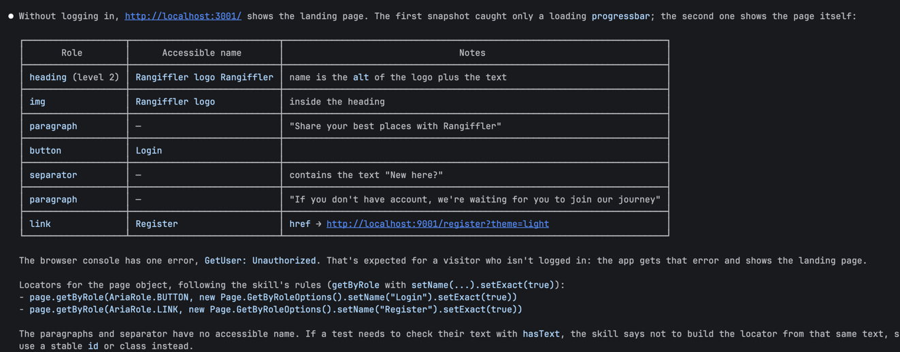

# Settings check

## Agent setup

- Agent: Claude Code
- Skill: `.claude/skills/rfr-page-objects/SKILL.md` (`name: rfr-page-objects`)
- Playwright MCP: `.mcp.json` → `npx @playwright/mcp@0.0.83 --isolated`, enabled in `.claude/settings.local.json`

## Q1: Какие правила skill rfr-page-objects относятся к конструктору и проверкам?

### Конструктор

- **Правило 3.** Конструктор и у страниц, и у компонентов принимает только `Page`. Внутри него только присвоение `page` и инициализация `private final` полей (локаторов и компонентов). В нём нельзя делать навигацию, ожидания, проверки и любые другие обращения к странице.
- **Правило 2.** Компонент находит свой корневой `Locator` в конструкторе и ищет элементы внутри него. Страница создаёт компоненты в конструкторе, хранит их в `private final` полях и отдаёт через геттер (`header()`).
- **Раздел «Локаторы».** Все локаторы — это `private final Locator` поля, которые инициализируются в конструкторе.
- **Правило 8.** На конструкторе `@Step` не ставится.

### Проверки

- **Правило 5.** В методах `check*` только проверки. В них нельзя вызывать `click`, `fill`, `navigate` и другие действия. Если для проверки нужно действие, это два отдельных метода.
- **Правило 6.** И наоборот: в методах действий нет проверок и явных ожиданий.
- **Правило 9.** Проверки пишутся только через `PlaywrightAssertions.assertThat` (`isVisible`, `hasText`, `hasValue`, `hasURL`, `hasCount`, `isDisabled`…), потому что они повторяются до таймаута. Нельзя использовать `locator.isVisible()`, `textContent()` или `inputValue()` вместе с JUnit `assertEquals`/`assertTrue`.
- **Правило 10.** Методов вроде `checkThatPageLoaded()` / `checkPageLoaded()` быть не должно. Проверять нужно результат действия и данные на странице.
- **Правило 4.** Константа `URL` используется в проверке `hasURL`, если сам адрес важен для теста (например, редирект после логина).
- **Правило 8.** На каждом `check*` стоит `@Step` с параметрами в тексте шага.
- **Правило 11.** Проверка, после которой пользователь остаётся на той же странице, возвращает `this`.
- **Раздел «Локаторы»**, пункты про проверки:
  - Локатор элемента, текст которого проверяется через `hasText`, нельзя строить по этому же тексту. Для таких элементов используется `id`, стабильный CSS-класс или роль без имени.
  - Регулярки в `hasURL(Pattern)` выполняются в браузере как JS RegExp, поэтому `Pattern.quote` использовать нельзя.

## Q2: Через Playwright MCP перечисли роли и доступные имена элементов на http://localhost:3001

Calls: `browser_navigate` → `http://localhost:3001`, then `browser_snapshot`. A user who isn't logged in sees the landing page. The raw snapshot is in [landing-snapshot.yml](landing-snapshot.yml).

| Role | Accessible name | Notes |
|---|---|---|
| `heading` (level 2) | `Rangiffler logo Rangiffler` | name is the `alt` of the logo plus the text |
| `img` | `Rangiffler logo` | inside the heading |
| `paragraph` | — | "Share your best places with Rangiffler" |
| `button` | `Login` | |
| `separator` | — | contains the text "New here?" |
| `paragraph` | — | "If you don't have account, we're waiting for you to join our journey" |
| `link` | `Register` | `href` → `http://localhost:9001/register?theme=light` |

The browser console has one error, `GetUser: Unauthorized`. That's expected for a visitor who isn't logged in: the app gets that error and shows the landing page.

Locators for the page object, following the skill's rules:

```java
page.getByRole(AriaRole.BUTTON, new Page.GetByRoleOptions().setName("Login").setExact(true));
page.getByRole(AriaRole.LINK, new Page.GetByRoleOptions().setName("Register").setExact(true));
```

Agent answer in the terminal:



## Правила, добавленные в skill

По итогам написания тестов профиля и негативных тестов логина в skill `rfr-page-objects` добавлены 10 правил. В `SKILL.md` каждое помечено *(добавлено)*. Откуда взялось каждое правило: [skill-added-rules.md](skill-added-rules.md).

**Правила**

12. **Действие, после которого возможен уход со страницы, ждёт свой запрос.** Метод ждёт ответ через `page.waitForResponse(predicate, button::click)`, иначе навигация оборвёт запрос, который ещё выполняется. Запрос узнаётся однозначно (для GraphQL — по `operationName`). Если в каком-то сценарии запрос не уходит (его блокирует клиентская валидация), нужен отдельный метод без ожидания.
13. **Сохранение проверяется после перезагрузки.** Значение в форме сразу после сохранения — состояние страницы, а не данные сервера.
14. **Проверка должна отличать правильное значение от любого другого.** Сравнивать с точным значением, а не с префиксом, признаком «не пусто» или «элемент есть».
15. **Локаторы ленивые.** Элементы, которые появятся позже (уведомления, ошибки валидации), тоже объявляются полями в конструкторе. В методе собирается только локатор, который зависит от параметра.

**Локаторы**

- **Элементы и `id` могут повторяться:** закрытые диалоги и порталы остаются в DOM. Искать внутри своей области (`main`, `dialog`, компонент). Ошибку strict mode violation исправлять сужением области, а не через `.first()` / `.nth()`.
- **Составное имя — фильтр по точному дочернему элементу.** Не искать по подстроке `hasText`: «user1» найдёт и «user10», «Save» — и «Save draft». Фильтровать через `setHas(<локатор с setExact(true)>)`.
- **Нет ни имени, ни `id`:** CSS по атрибуту внутри области и комментарий, почему этот локатор однозначен.

**Организация тестов**

- Пакет по области приложения (`test/auth`, `test/profile`), негативные сценарии — в отдельном классе `*NegativeTest`.
- Тестовые данные готовятся фикстурами (`@User`), а не через UI, если сам UI-путь не предмет теста. Базового класса теста нет: общие шаги — `private static` метод в классе.
- Случайные данные только там, где нужна уникальность (имя пользователя, пароль). Остальные значения — конкретные константы, чтобы падение воспроизводилось.
